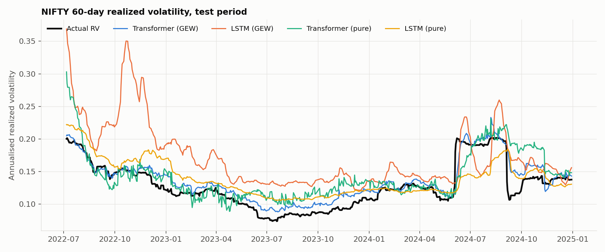
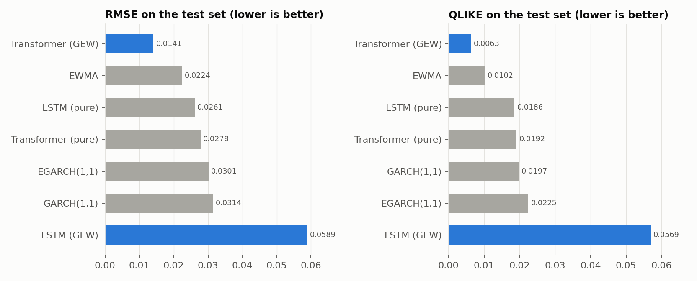
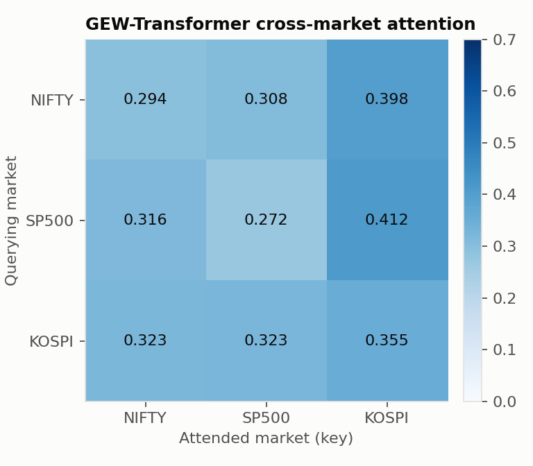
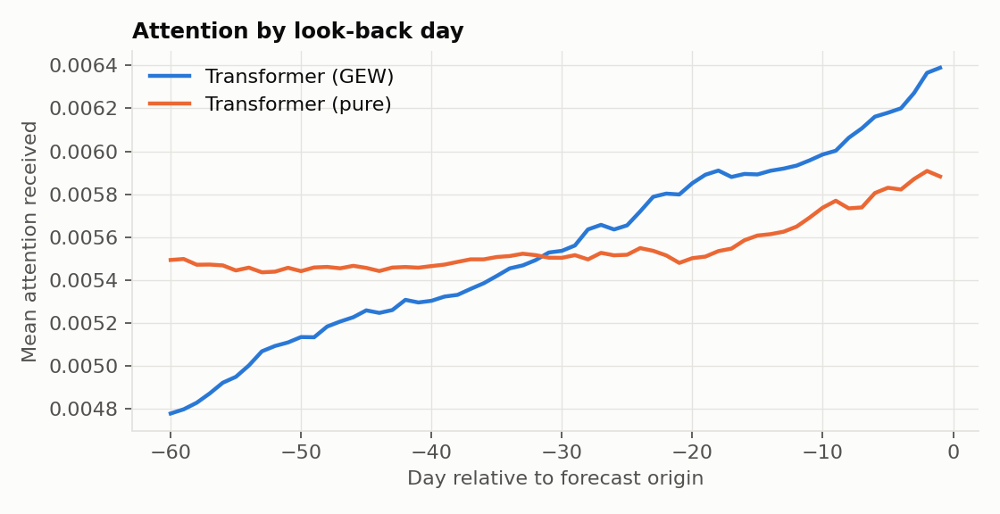

# GEW-Transformer: NIFTY 50 realized-volatility forecasting

[](https://github.com/dhootatharva/gew-transformer-volatility/actions/workflows/tests.yml)


[](LICENSE)

A Transformer encoder fed with GARCH(1,1), EGARCH(1,1) and EWMA volatility forecasts ("GEW" features) from NIFTY 50, S&P 500 and KOSPI, compared against econometric baselines, an LSTM, and both networks without the econometric features. MS thesis project, 2026.

## Results

Out-of-sample forecasts of NIFTY 50 60-day realized volatility, 565 test days (2022-07-06 to 2024-12-30). All numbers below were produced by `python scripts/reproduce.py` on CPU; lower is better for every column.

| Model | RMSE | MAE | HMAE | HMSE | QLIKE |
|---|---:|---:|---:|---:|---:|
| GARCH(1,1) | 0.031383 | 0.022722 | 0.174448 | 0.048155 | 0.019704 |
| EGARCH(1,1) | 0.030113 | 0.022645 | 0.172840 | 0.045883 | 0.022467 |
| EWMA | 0.022428 | 0.015370 | 0.109063 | 0.019494 | 0.010168 |
| LSTM (pure) | 0.026086 | 0.022078 | 0.181513 | 0.046132 | 0.018598 |
| LSTM (GEW) | 0.058863 | 0.048086 | 0.394632 | 0.218335 | 0.056905 |
| Transformer (pure) | 0.027800 | 0.020723 | 0.177910 | 0.057368 | 0.019183 |
| **Transformer (GEW)** | **0.014113** | **0.010994** | **0.096098** | **0.015293** | **0.006262** |

- The GEW-Transformer has the lowest error on all five metrics: RMSE 49% below the same Transformer without GEW features, and 37% below the best econometric baseline (EWMA).
- The LSTM does not benefit from the GEW features in this run (RMSE 0.0589 vs 0.0261 without them). It is trained with 20 full-batch steps and no early stopping, and its result depends strongly on the random initialisation.
- **Thesis reproduction.** With the original notebook's normalisation (`--normalisation global`, see Implementation notes), the GEW-Transformer scores RMSE 0.013447 and QLIKE 0.005754, against 0.0133 and 0.0056 reported in the thesis. The headline table above uses training-split normalisation only, which costs about 5% RMSE.

**Diebold-Mariano tests** (squared-error loss, two-sided; negative statistic = first model more accurate):

| Comparison | DM statistic | p-value | DM, Newey-West (10 lags) | p-value |
|---|---:|---:|---:|---:|
| Transformer (GEW) vs LSTM (GEW) | -13.310 | 2.41e-35 | -4.332 | 1.75e-05 |
| Transformer (GEW) vs Transformer (pure) | -11.826 | 5.53e-29 | -4.140 | 4.00e-05 |
| LSTM (GEW) vs LSTM (pure) | 11.306 | 7.41e-27 | 3.678 | 2.57e-04 |
| Transformer (GEW) vs LSTM (pure) | -16.233 | 6.60e-49 | -5.441 | 7.93e-08 |
| Transformer (GEW) vs GARCH(1,1) | -6.736 | 4.03e-11 | -2.845 | 4.60e-03 |

The GEW-Transformer's advantage over every other model stays significant at the 1% level after correcting for autocorrelated forecast errors.





Raw outputs: [`results/metrics.csv`](results/metrics.csv), [`results/dm_tests.csv`](results/dm_tests.csv), [`results/test_predictions.csv`](results/test_predictions.csv). The notebook-normalisation run is in [`results/notebook_normalisation/`](results/notebook_normalisation/).

## Method

**Data.** Daily closes of NIFTY 50 (`^NSEI`), S&P 500 (`^GSPC`) and KOSPI (`^KS11`) from Yahoo Finance (requested 1995-01-01 to 2025-01-01), inner-joined on trading date. The common sample starts on 2007-09-17 (3,937 aligned days up to 2024-12-30). Prices are downloaded at run time and cached in `data/` (not committed).

**Target.** Annualised realized volatility over a trailing h = 60 day window,
RV<sub>t</sub> = std(r<sub>t-59</sub>, ..., r<sub>t</sub>) x sqrt(252), with r<sub>t</sub> = ln(P<sub>t</sub>/P<sub>t-1</sub>). The model forecasts NIFTY 50 RV one step past its input window.

**GEW features.** For every day t and every market, GARCH(1,1), EGARCH(1,1) (both MLE via `arch`, constant mean, normal errors) and EWMA (lambda = 0.94) are re-fitted on all returns up to day t-1 (expanding window, returns clipped to +-10%) and their one-step-ahead sigma for day t is stored. That is about 23,000 model fits per run; they are cached after the first run. Per market and day the feature vector is

| Variant | Features per market | Input dimension (3 markets) |
|---|---|---|
| GEW | r, RV, sigma<sub>GARCH</sub>, sigma<sub>EGARCH</sub>, sigma<sub>EWMA</sub> | 15 |
| Pure | r, RV | 6 |

**Samples and split.** Each sample is a look-back window of L = 60 days (rows t-60 ... t-1) with target RV<sub>t+1</sub> of NIFTY 50. The 3,766 samples are split chronologically 70 / 15 / 15 into train / validation / test (2,636 / 565 / 565); the test targets run from 2022-07-06 to 2024-12-30. Features are cleaned (NaN to 0, clipped to +-5) and z-scored with training-split statistics.

**Models.**

| | LSTM | Transformer |
|---|---|---|
| Core | 2 x LSTM(64), dropout 0.2 | 4 post-norm encoder layers, d_model 160, 4 heads, FFN 320, dropout 0.05 |
| Multi-market input | features concatenated per day | tokens = (day, market) pairs, 60 x 3 = 180 tokens; learned market embedding, single-head attention across markets per day, fixed per-feature weights, sigmoid feature gate, learned positional embedding, exponential recency decay |
| Head | Linear(64,32)-ReLU-Linear | mean of the last day's 3 tokens, LayerNorm-Linear(160,64)-ReLU-Linear, plus the last day's mean RV as a residual |
| Target | raw RV | RV standardised with training mean / std |
| Training | Adam lr 1e-3, MSE, full batch, 20 epochs | Adam lr 5e-5, Huber loss, batch 64, grad-norm clip 1.0, 60 epochs |

No early stopping or model selection on the validation set is done; the validation loss is only logged (`results/training_history.csv`). Seed 42 for Python, NumPy and PyTorch.

**Econometric baselines.** The same expanding-window GARCH / EGARCH / EWMA one-step sigma for day t (information up to t-1, the same information set as the networks), annualised with sqrt(252), used directly as the forecast of RV<sub>t+1</sub>.

**Metrics** (y = realized, y-hat = forecast, averaged over the 565 test days): RMSE, MAE, HMAE = mean|1 - y-hat/y|, HMSE = mean(1 - y-hat/y)<sup>2</sup>, QLIKE = mean(y/y-hat - ln(y/y-hat) - 1). QLIKE is non-negative, zero for a perfect forecast and penalises under-prediction more than over-prediction (Patton, 2011).

**Diebold-Mariano test.** Squared-error loss differential d<sub>t</sub> = e<sub>1,t</sub><sup>2</sup> - e<sub>2,t</sub><sup>2</sup>, statistic mean(d) / sqrt(var(d)/n), two-sided p-value from Student-t with n-1 df. A negative statistic favours model 1.

## Cross-market attention

The GEW-Transformer attends over 180 tokens (60 days x 3 markets). Averaging the attention maps over the 4 encoder layers, the heads and the 565 test samples, and summing over days, gives a 3 x 3 market-to-market matrix (rows normalised to 1). Reading the NIFTY row:

| Attended market | Weight (this run) | Weight (notebook normalisation) | Thesis |
|---|---:|---:|---:|
| NIFTY 50 (self) | 0.294 | 0.305 | 0.305 |
| S&P 500 | 0.308 | 0.311 | 0.311 |
| KOSPI | 0.398 | 0.384 | 0.384 |

NIFTY tokens place more attention on KOSPI and S&P 500 tokens than on NIFTY's own history, in both runs. The weights are close to uniform (1/3 each), so this is a modest tilt rather than a dominant effect, and attention weights describe where the model looks, not causal spillover. Attention also rises towards the most recent days, more steeply with GEW features than without.

<p>


</p>

The full time-by-time attention map is in [`results/figures/attention_heatmap.png`](results/figures/attention_heatmap.png).


## Implementation notes

The code is a cleaned-up port of the thesis notebook. The model architectures, features, hyperparameters, split and seed are unchanged. The following were fixed; each changes what is measured, so they are listed explicitly.

1. **Feature normalisation leaked test data.** The notebook z-scored the feature tensors with the mean and standard deviation of all samples, including the test period. The statistics are now fitted on the training split only, as the thesis describes. `--normalisation global` restores the notebook behaviour (results in `results/notebook_normalisation/`).
2. **Transformer target scaling leaked test data.** The target was standardised with the full-sample mean and standard deviation of RV before training, and predictions were de-standardised with the same values. Training-split statistics are now used (`--normalisation global` restores the original).
3. **GEW and pure models were evaluated on different targets.** In the notebook session that produced the thesis table, the pure-feature datasets had been built after the data pipeline was re-run with a 22-day RV window and a one-day lag on the S&P 500 series, while the GEW datasets used the 60-day RV. The pure models therefore forecast a different, noisier series (578 test days instead of 565), and the Diebold-Mariano tests compared their errors against the GEW targets after trimming to equal length. Both variants are now built from the same returns and RV on the same samples, so all models share the same 565 test targets.
4. **Econometric baselines compared daily and annualised volatility.** The notebook fitted GARCH/EGARCH/EWMA on the flattened, overlapping 60-day input windows (each return repeated up to 60 times, out of order) and compared the resulting daily sigma (about 0.011) with annualised RV (about 0.18). The resulting RMSE of about 0.16 measured the unit mismatch rather than forecast skill. The baselines now use the expanding-window GEW sigma for the forecast day, annualised with sqrt(252), on the same test days as the networks.
5. **LSTM seeding.** The notebook seeded PyTorch after constructing the LSTM, so its initial weights depended on what had run earlier in the session. The seed is now set before the model is built.
6. **Small items.** DM p-values use the survival function, so very small values are reported instead of rounding to 0. Test-set attention is accumulated in batches instead of holding a 4 x 565 x 180 x 180 tensor in memory (same average).

Kept as in the thesis code, but worth knowing:

- The input window ends at day t-1 and the target is RV at day t+1, so the most recent day is not used as an input.
- The thesis text describes L = 22 and a 22-day RV target; the notebook run that produced the reported numbers (and this repository) uses L = 60 and a 60-day RV.
- The GEW features are fitted on an expanding window (all history up to t-1), not a fixed trailing window.
- There is no early stopping; the model after the last epoch is evaluated.
- A 60-day RV changes slowly (consecutive targets share 59 of 60 returns), so forecast errors are strongly autocorrelated. The plain DM statistic used in the thesis ignores this and overstates significance. The results table therefore also reports a Newey-West (10 lags) version.

## How to run

Requires Python 3.10+. CPU is enough.

```bash
python -m venv .venv
# Windows: .venv\Scripts\activate    macOS/Linux: source .venv/bin/activate
pip install -r requirements.txt --extra-index-url https://download.pytorch.org/whl/cpu
pip install -e .

python scripts/reproduce.py                          # full run -> results/
python scripts/reproduce.py --normalisation global   # original notebook normalisation -> results/notebook_normalisation/
python scripts/reproduce.py --smoke                  # 1 epoch per model, pipeline check -> results/smoke/
pytest                                               # unit tests
```

**Runtime (CPU only, 8-core laptop).** Fitting the GARCH/EGARCH/EWMA series takes about 19 minutes (one process per market) and is cached in `data/cache/`. The LSTMs take under 5 minutes each. The Transformers dominate: 60 epochs at roughly 3.5 to 9 minutes per epoch depending on load. Training the four Transformers of both normalisation modes as four parallel `--only` processes (2 threads each) took about 7 hours of wall-clock time; a single sequential `python scripts/reproduce.py` needs about 4.5 hours per Transformer. Most of the Transformer time goes to CPU random-number generation for attention dropout. No setting was reduced for the reported numbers.

```bash
# parallel variant used for the reported results
python scripts/reproduce.py --only "Transformer (GEW)" --threads 2 &
python scripts/reproduce.py --only "Transformer (pure)" --threads 2 &
python scripts/reproduce.py --only "LSTM (GEW)" --only "LSTM (pure)"
wait
python scripts/reproduce.py      # loads the cached models, writes tables and figures
```

Outputs: `results/metrics.csv`, `results/dm_tests.csv`, `results/results.md`, `results/market_spillover.csv`, `results/test_predictions.csv`, `results/training_history.csv`, `results/run_info.json` (data range, split sizes, timings, library versions) and the figures in `results/figures/`.

## Project structure

```
src/gewvol/
  config.py                 all settings (data, LSTM, Transformer, seed)
  pipeline.py               end-to-end run: data -> features -> models -> tables and figures
  data/
    loader.py               Yahoo Finance download, local cache, inner join
    features.py             log returns, rolling realized volatility
    sigma.py                expanding-window GARCH / EGARCH / EWMA series (parallel, cached)
    sequences.py            GEW and pure windows, chronological split, normalisation
  models/
    econometric.py          GARCH(1,1), EGARCH(1,1), EWMA one-step forecasts
    lstm.py                 LSTM regressor
    transformer.py          multi-market Transformer with attention outputs
  training/
    train_lstm.py           LSTM experiment
    train_transformer.py    Transformer experiment, batched attention aggregation
  evaluation/
    metrics.py              RMSE, MAE, HMAE, HMSE, QLIKE
    stat_tests.py           Diebold-Mariano test
    attention.py            lag importance and cross-market attention matrix
  visualization/plots.py    figures
scripts/reproduce.py        single entry point
tests/                      metric formulas, no-look-ahead checks, model shapes, DM test
results/                    generated tables and figures
```

## References

- H. Y. Kim and C. H. Won, "Forecasting the volatility of stock price index: A hybrid model integrating LSTM with multiple GARCH-type models," *Expert Systems with Applications*, vol. 103, pp. 25-37, 2018.
- T. Bollerslev, "Generalized autoregressive conditional heteroskedasticity," *Journal of Econometrics*, vol. 31, no. 3, pp. 307-327, 1986.
- D. B. Nelson, "Conditional heteroskedasticity in asset returns: A new approach," *Econometrica*, vol. 59, no. 2, pp. 347-370, 1991.
- A. Vaswani et al., "Attention is all you need," *Advances in Neural Information Processing Systems 30*, pp. 5998-6008, 2017.
- S. Hochreiter and J. Schmidhuber, "Long short-term memory," *Neural Computation*, vol. 9, no. 8, pp. 1735-1780, 1997.
- F. X. Diebold and R. S. Mariano, "Comparing predictive accuracy," *Journal of Business & Economic Statistics*, vol. 13, no. 3, pp. 253-263, 1995.
- A. J. Patton, "Volatility forecast comparison using imperfect volatility proxies," *Journal of Econometrics*, vol. 160, no. 1, pp. 246-256, 2011.
- K. Sheppard, `arch`: ARCH models in Python, https://github.com/bashtage/arch.

## License

MIT, see [LICENSE](LICENSE).
